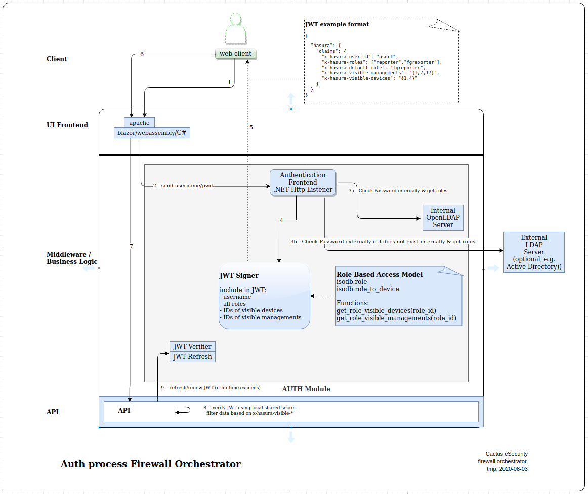

# Authentication and Authorization in Firewall Orchestrator

Users can either be stored in the local LDAP server that comes with the Firewall Orchestrator or you may use one or more external LDAP servers (recommended).


## Implementation
In Firewall Orchestrator all permissions are tied to roles which are enforced solely in the API layer. 
Therefore we can ensure the same access security via API access as whithin the product itself.

Also have a look at
- the [role based access control model](rbac.md)
- how to [define roles & permissions in hasura](https://hasura.io/docs/1.0/graphql/manual/auth/authorization/index.html)
  - For an example see <https://dev.to/lineup-ninja/modelling-teams-and-user-security-with-hasura-204i>
  - see [hasura doc on auth](https://hasura.io/docs/1.0/graphql/manual/auth/authorization/roles-variables.html)



## Roles

The latest and most detailed role based acccess model can always be found in the help pages of Firewall Orchestrator itself.

There is also multi-tenancy support which you can use to implement per-tenant permissions for defined firewall gateways.

See <rbac.md>

## Login name

Users log in with their account name: `sAMAccountName` for an Active Directory connection, `uid` for an OpenLDAP
connection, and for a connection of the default type the `sAMAccountName` of an entry that has one, otherwise its
`uid`. The middleware looks up exactly one entry with
an exact match on this attribute and checks the password only for that entry. Other names of the same account, such
as the `cn`, the `userPrincipalName`, the mail address or a further value of a multi-valued `uid`, are not accepted
(since 9.7.1). Login names containing LDAP filter characters (`*`, `\`, `(`, `)` or NUL) are rejected without any
directory access.

Logins with the `userPrincipalName` or the mail address are not supported on purpose. Unlike the account name, these
attributes are not guaranteed to be unique within a directory and across the connected directories, and a login
that matched several entries could select another account than the one the user intended. Users who logged in with
one of these names before 9.7.1 have to use their account name. The LDAP type of a connection (settings, LDAP
connections) determines which attribute is the account name.

## Several LDAP connections

A distinguished name (dn) is unique only inside one directory, but roles and groups (`uniqueMember`), owner
responsibles, workflow visibility groups and workflow assignments refer to users and groups by their bare dn. Since
9.7.2 (GHSA-695m-f6mv-9g72) every dn therefore belongs to exactly one LDAP connection:

- An active connection owns the subtrees below its paths: user, role and group search paths and the group write
  path. If paths of two active connections are nested (e.g. the forest root and a child domain), the more specific
  path wins; a dn below the same path of two active connections belongs to neither.
- The paths of an active connection must not equal a path of another active connection. Saving such a
  connection is refused (UI message `E5273`, REST `400`). Replicas of one directory are therefore not configured as
  separate connections but as servers of one connection (see below). Existing connections sharing a path are reported
  as a warning by the upgrade to 9.7.2 and at every start of the middleware; users below a shared path can no longer
  log in until the paths are distinct (Settings - LDAP Connections).
- A user entry or a group whose dn lies outside the paths of the directory that returned it is ignored, so a
  directory cannot claim a dn of another directory.
- The workflow compares the requester and the handler of a ticket by the local user id, and resolves the group
  memberships of a caller in the directory of the caller's local user.
- User administration (`api/User`: change, change password, reset password, delete) always acts on the directory of
  the local user; an `LdapId` of another connection is rejected. A user can only be added to one writable connection
  (`LdapId` is required when several connections are writable), and its dn has to lie within the paths of that
  connection. A group search (`api/Group/Get`) covers exactly the connection given by `LdapId`.

## Several servers of one directory

A connection lists up to 10 servers (names or ip addresses, `ldap_server` is an array since 9.7.2) of one directory,
e.g. replicas for availability. They share the port and all other settings of the connection. The middleware tries
them in the given order and keeps using the server that answered last, so a failed server delays only the first
directory operation after its failure. "Test connection" checks every server. In the UI the servers are entered
separated by commas; via REST they are sent as the list `Addresses`.

Before 9.7.2 replicas could only be configured as separate connections with the same paths. Such connections now
overlap: the upgrade and the middleware log a warning, and their users cannot log in until the servers are combined
into one connection and the other connections are deactivated or deleted. Each of the old connections has its own
local users (keyed by connection and dn), so keep the connection whose local users should be kept.

## Binding local users to directory entries

A dn can be handed to another person, e.g. when an account is deleted and a later one gets the same name. Since 9.7.2
a local user is therefore bound to the immutable object id of its directory entry (`uiuser.directory_object_id`),
read from the first of these attributes that the entry has: `objectGUID` (Active Directory), `entryUUID` (OpenLDAP,
including the internal LDAP, and newer 389 Directory Server), `nsUniqueId` (389 / Red Hat Directory Server),
`ipaUniqueID` (FreeIPA) or `GUID` (eDirectory).

- A local user is bound at its first login with password after the upgrade. A token refresh or a rebuild without
  password (scheduled reports, delegated tokens) cannot tell whether the dn still names the same person and does not
  bind. The upgrade to 9.7.2 therefore ends the sessions (refresh tokens) of all local users that are not bound yet.
- When the entry of a bound local user is renamed or moved, the local user follows it to the new dn. This includes a
  change of only the case or escaping of the dn (e.g. `uid=mueller` to `uid=Mueller`).
- When the dn of a bound local user names another entry, or an entry without object id, login, token refresh,
  scheduled reports and delegated tokens for it are refused with `A0008`, and all sessions of the local user are
  ended. The audit log names the local user. If the dn belongs to a new person, delete the old local user
  (Settings - Users); the new person then gets a new local user at the next login. Deleting a bound local user only
  deletes its directory entry (in a writable directory) while the dn still names its own object; the entry of the new
  person is kept and only the old local user is deleted. If it is still the same person
  (e.g. an account restored with a new object id), clear `uiuser.directory_object_id` of the local user instead; the
  next login with password binds it again.
- Directories that provide none of these attributes keep the binding by connection and dn only.

## Login limits

Every login with credentials makes the middleware search and bind in the active LDAP connections. To keep
unauthenticated requests from turning into a flood of directory operations, the login endpoints
(`AuthenticationToken/GetTokenPair`, `Get`, `GetTokenPairForUser`, `GetForUser`) are limited as follows:

| Limit | Default | Answer when exceeded |
|---|---|---|
| Credentialed login attempts per client address and minute | 30 | `429` with `A0006` and `Retry-After` |
| Failed logins per user name and client address and minute (running attempts count as possible failures) | 10 | `429` with `A0006` and `Retry-After` |
| Active LDAP connections one login may be tried against | 16 | `503` with `A0007` (logged as error) |
| Logins waiting for LDAP at the same time | 32 | `429` with `A0006` |
| LDAP operations running at the same time (user searches, password checks, group and role lookups of all logins) | 4 | queued until a slot is free |
| Time for all directory work of one login | 10 s | `503` with `A0007` |

Anonymous token requests (no user name or password) cause no LDAP work and are never limited. When a login runs out
of time or its HTTP request is cancelled, the middleware closes the login's LDAP connections, and every directory
operation of a login waits at most 10 s for an answer (the LDAP library does not stop a waiting operation otherwise).
So a directory that does not answer cannot keep the LDAP slots occupied for longer than that. A directory that needs
more than 10 s for a login cannot be used for logins.
Token refreshes are not rate limited, as they require a valid refresh token, but share the deadline; a refresh that
runs out of time answers `503` without consuming the token.

The client address is the one the local Apache reverse proxy appends to `X-Forwarded-For`. Addresses of the
middleware host itself and the UI hosts are exempt from the per-client limit, because every login through the UI
arrives from the UI server's address. The per-user failure limit still applies to them, so repeated wrong
passwords for one user through the UI block further attempts for that user from the UI for up to a minute.
This includes service accounts such as `importer` when they log in from the same host as the UI.

As logins through the UI are not limited per client, the limits that apply to all logins together (logins waiting
for LDAP, LDAP operations at the same time) can be reached by anyone who sends many logins with arbitrary user names
through the UI login form. Other users then get `429` or `503` until the flood stops; the directories themselves are
not overloaded.

The limits can be changed in `/etc/fworch/fworch.json`; the middleware reads them at startup:

```json
{
  "login_max_directories": 16,
  "login_client_attempts_per_minute": 30,
  "login_user_failures_per_minute": 10,
  "login_trusted_client_hosts": ["ui-srv", "192.168.121.2"]
}
```

`login_trusted_client_hosts` is written by the installer from the `frontends` inventory group (inventory names
and `ansible_host` values). It is refreshed on every upgrade, so set the inventory variable
`login_trusted_client_hosts` instead of editing the file if you need other hosts. Host names that cannot be
resolved at startup are logged as a warning and not exempt. The inventory variable may be a list, a comma separated
string (`-e login_trusted_client_hosts=ui1,ui2`) or a JSON list given as a string
(`-e 'login_trusted_client_hosts=["ui1","ui2"]'`).

The middleware also reads hand-edited values: the numbers may be given as strings (`"16"`) and
`login_trusted_client_hosts` as a comma separated string. A value of another type is ignored with a warning in the
log, and the default applies.

## API request limits

Every request to the middleware REST API with a user token counts against a budget of that user (identified by
the `x-hasura-uuid` claim): by default 600 requests per minute, with bursts of up to one minute's budget. The budget
is refilled at least every 10 seconds (below 60 per minute: one request every 60 / value seconds); a configured value
that cannot be refilled exactly within such a period is rounded by at most 3 requests per minute. Endpoints
whose single requests are expensive (`getFlowComplianceState`, `getIpDataForOwners` and the Flow catalog lists
`getAddressObjects`, `getAddressGroups`, `getServiceObjects`, `getServiceGroups`, `getTimeObjects`) additionally
run at most 2 requests of one user at the same time; up to 4 further requests wait, the rest are rejected. Their
request bodies are limited to 1 MiB (`413` above). Rejected requests get `429` with `Retry-After: 60`.

Service identities (`importer`, `middleware-server`), anonymous login tokens and unauthenticated requests are not
counted here; logins are limited as described above.

The limits can be changed in `/etc/fworch/fworch.json`; the middleware reads them at startup, and values of a wrong
type are ignored like the login limits:

```json
{
  "rate_limit_requests_per_minute": 600,
  "rate_limit_concurrent_expensive_requests": 2
}
```

The list endpoints above return one page per request: `getIpDataForOwners` at most 10000 applications, the
object lists at most 1000 items and the group lists at most 250, which is also the default when no limit is sent. Items are ordered by name and
id; page with `limit` and `offset` (`options.limit`/`options.offset` for `getIpDataForOwners`) until the response
header `X-Has-More` is `false`. `getFlowComplianceState` accepts at most 100 entries in each of `source`,
`destination` and `service`, and at most 100 `policies`.
